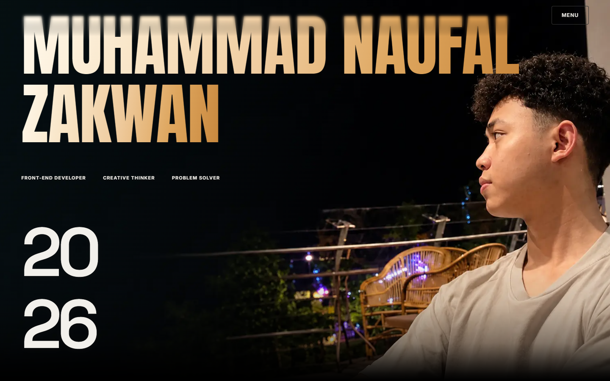
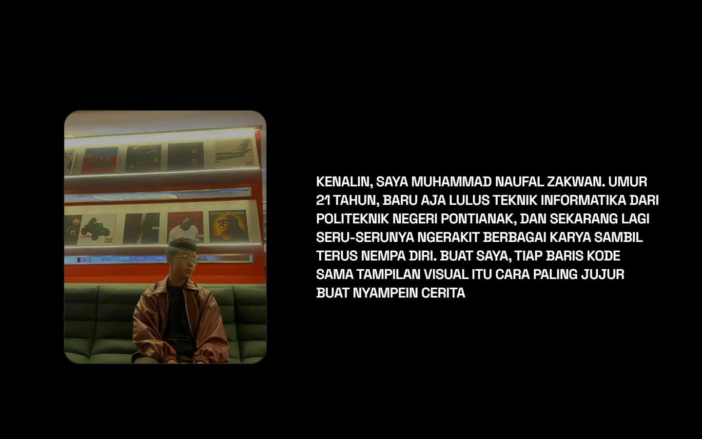
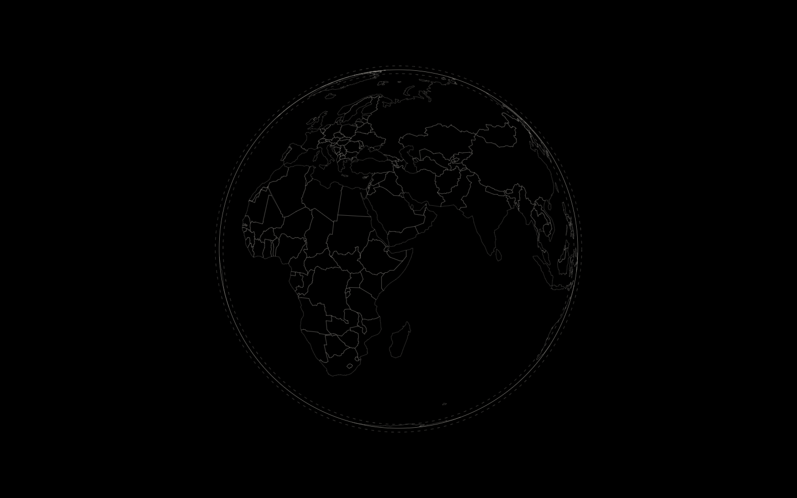
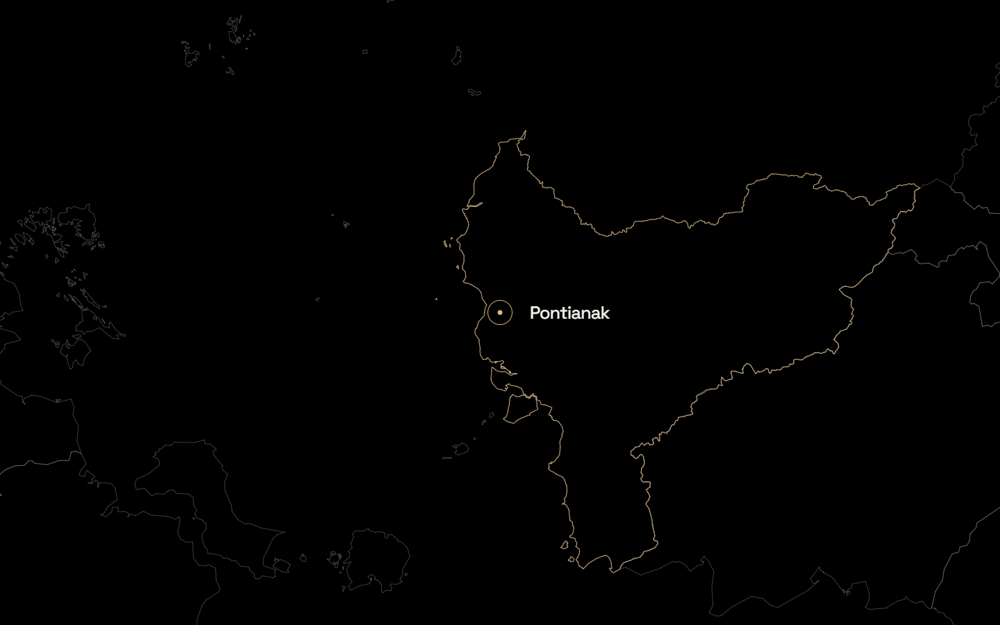
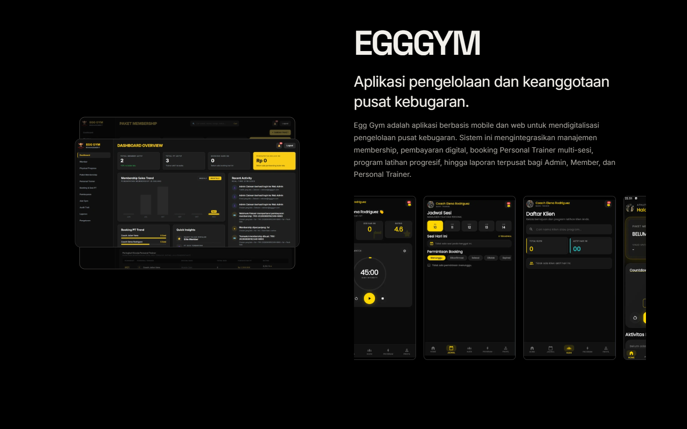
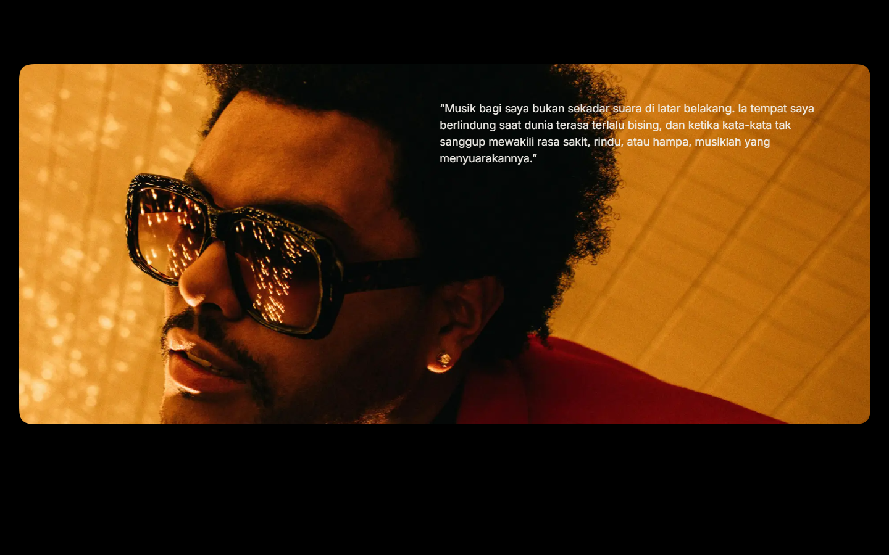
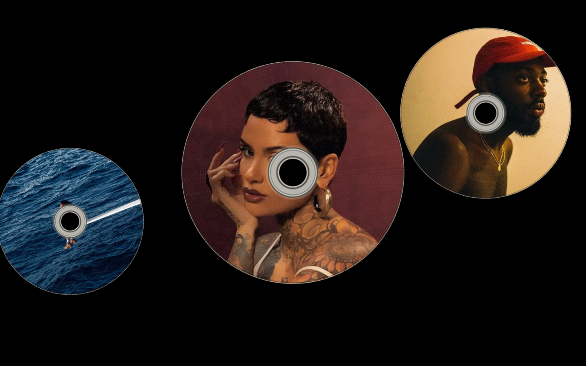
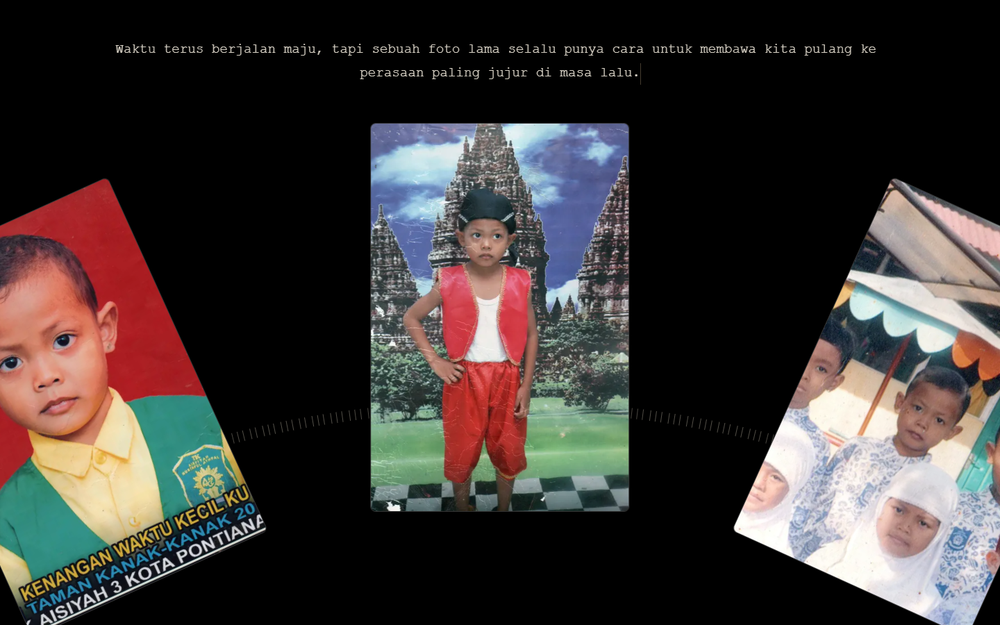
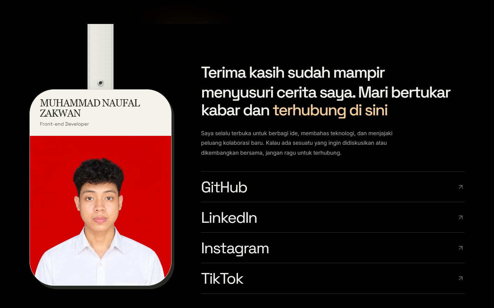
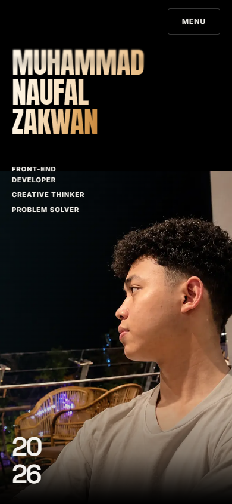

# Muhammad Naufal Zakwan

### Personal Portfolio Website

**Front-end Developer | Creative Thinker | Problem Solver**

Website portofolio pribadi yang memadukan desain editorial, animasi interaktif, dan *scroll-driven storytelling*. Melalui website ini, saya membagikan karya, kemampuan pengembangan web, dan cerita personal—mulai dari Pontianak, musik, hingga perjalanan dan kenangan yang membentuk diri saya.

[GitHub](https://github.com/naufalzakwan) · [Fitur](#fitur-utama) · [Screenshot](#screenshot-website) · [Demo](#live-demo) · [Cara Menjalankan](#cara-menjalankan)

---

## Tentang Proyek

Saya **Muhammad Naufal Zakwan**, seorang Front-end Developer dari Pontianak, Indonesia. Saya membangun portofolio ini bukan hanya sebagai tempat menampilkan proyek, tetapi juga sebagai pengalaman interaktif yang memperkenalkan sosok di balik karya tersebut.

Dengan perpaduan warna hitam, cokelat, dan beige, tipografi yang tegas, serta animasi berbasis scroll, setiap bagian website dirancang untuk menyampaikan cerita secara bertahap. Portofolio ini dikembangkan secara independen dan tidak mewakili perusahaan atau program magang tertentu.

## Fitur Utama

- **Hero & About** — Perkenalan diri melalui komposisi foto, tipografi editorial, dan animasi teks.
- **Interactive Globe** — Visualisasi bumi dengan Canvas 2D yang bergerak mengikuti scroll dan mengarahkan pengunjung menuju Pontianak.
- **Personal Storytelling** — Cerita tentang kota asal, keluarga, karakter, dan perjalanan pribadi.
- **Project Showcase** — Galeri interaktif untuk menampilkan proyek **EGGGYM**.
- **Tech Stack Cards** — Kartu teknologi responsif dengan interaksi *flip*.
- **Music Experience** — Transisi animasi ikon musik, banner musisi, dan koleksi delapan album berbentuk CD.
- **Zodiac / Pisces** — Visualisasi zodiak, kartu berlapis, dan animasi berbasis scroll.
- **Typewriter & Memories** — Efek pengetikan dan orbit foto yang menghubungkan rangkaian cerita hingga wisuda.
- **Navigasi Interaktif** — Menu layar penuh, navigasi keyboard, tautan media sosial, dan tombol kembali ke atas.
- **Responsif & Aksesibel** — Penyesuaian animasi pada layar kecil, dukungan *reduced motion*, dan optimasi pekerjaan animasi di luar viewport.

## Teknologi yang Digunakan

| Kategori | Teknologi |
| --- | --- |
| Framework | Next.js 16 (App Router), React 19 |
| Bahasa | TypeScript |
| Styling | CSS Modules, CSS Custom Properties, Tailwind CSS 4 |
| Animasi | GSAP, ScrollTrigger, SplitText, `@gsap/react`, Lenis |
| Grafis | Canvas 2D dan SVG |
| Gambar & Font | `next/image`, WebP/PNG/SVG, Anton, Inter, Space Grotesk |
| Ikon | Lucide React dan logo teknologi lokal |
| Tools | npm, ESLint, TypeScript |

**Catatan pengembangan:** Animasi dan pengalaman scroll telah disesuaikan untuk berbagai ukuran layar. Pengujian pada perangkat fisik tetap diperlukan karena performa dapat berbeda menurut perangkat dan browser. README ini tidak mengklaim skor Lighthouse atau FPS tertentu.

## Screenshot Website

Seluruh screenshot berikut diambil dari website yang dijalankan secara nyata, bukan dari mockup atau gambar hasil AI. Tampilan desktop menggunakan viewport **1440 × 900**, sedangkan tampilan mobile menggunakan **390 × 844**.

| Hero | About |
| --- | --- |
|  |  |

| Globe | Pontianak |
| --- | --- |
|  |  |

| EGGGYM | Musik |
| --- | --- |
|  |  |

| Playlist | Memories |
| --- | --- |
|  |  |

| Kontak | Mobile |
| --- | --- |
|  |  |

> Pastikan folder `screenshots/` dan seluruh file PNG di atas ikut di-*push* ke GitHub agar gambarnya muncul di README.

## Live Demo

**Tautan website:** Akan ditambahkan setelah portofolio pribadi ini di-*deploy* melalui project hosting yang baru.

Setelah domain baru tersedia, konfigurasi `SITE_URL` dapat diperbarui sesuai petunjuk pada `.env.example` agar metadata *canonical URL* mengarah ke domain yang benar.

## Cara Menjalankan

Gunakan **Node.js 22.x** dan **npm**. Setelah repository tersedia secara publik, jalankan:

```bash
git clone https://github.com/naufalzakwan/naufalzakwan-portfolio.git
cd naufalzakwan-portfolio
npm ci
npm run dev
```

Buka **http://localhost:3000** untuk melihat website secara lokal.

Untuk membuat dan menjalankan versi *production*:

```bash
npm run build
npm run start
```

Pemeriksaan kode yang juga tersedia:

```bash
npm run lint
npm run typecheck
```

Jika port 3000 sedang digunakan, jalankan `npm run dev -- --port 3001`.

## Kontak

**Muhammad Naufal Zakwan**\
Front-end Developer — Pontianak, Indonesia

- **GitHub:** [@naufalzakwan](https://github.com/naufalzakwan)
- **LinkedIn:** [Muhammad Naufal Zakwan](https://www.linkedin.com/in/muhammad-naufal-zakwan/)
- **Instagram:** [@naufalzkwan](https://www.instagram.com/naufalzkwan)

> Pastikan tautan LinkedIn dan Instagram di atas adalah akun yang ingin kamu tampilkan secara publik.

## Credits & Inspirasi

Referensi desain, atribusi data peta, lisensi font, dan penggunaan aset pihak ketiga dijelaskan dalam [CREDITS.md](CREDITS.md).

Portofolio ini adalah karya pribadi. Penyebutan musisi, merek, atau referensi desain tidak menunjukkan afiliasi maupun dukungan resmi dari pihak tersebut. Publikasi repository juga tidak otomatis memberikan izin penggunaan ulang foto atau aset milik pihak ketiga.
